<table align="center" style="border: 1px solid #00FF41; border-collapse: separate; border-spacing: 10px; background-color: #050505; border-radius: 8px;">
  <tr>
    <td>
      
    </td>
    <td>
      
    </td>
    <td>
      
    </td>
    <td>
      
    </td>
    <td>
      
    </td>
  </tr>
</table>

<a href="https://lestofc.vercel.app/">
  
</a>

<a href="https://lestofc.vercel.app/">
</a>

<a href="https://lestofc.vercel.app/">
</a>

<a href="https://lestofc.vercel.app/">
</a>

<a href="https://lestofc.vercel.app/">
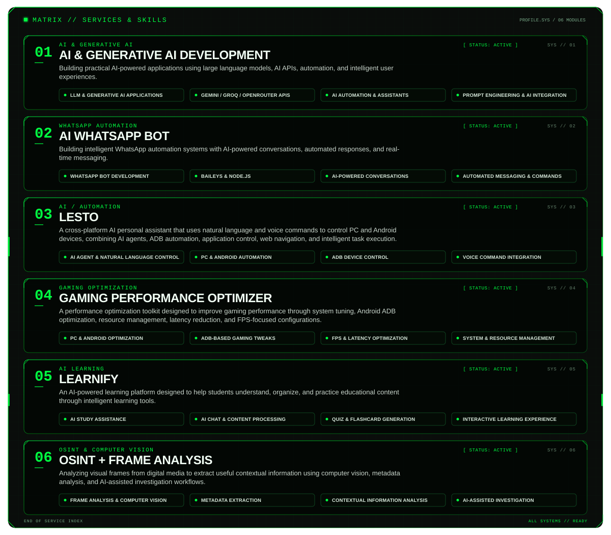
</a>

<a href="https://lestofc.vercel.app/">
</a>

<a href="https://github.com/HELLBOYSHADOW/Learnify-AI/releases/tag/v2.0.0">
</a>

  

<a href="https://wa.me/918075457421/">
</a>

  

<a href="https://ambience-six.vercel.app/">
</a>

  

<a href="https://lestofc.vercel.app/">
</a>

  

<a href="https://lestofc.vercel.app/">
</a>

<a href="https://lestofc.vercel.app/">
  
</a>